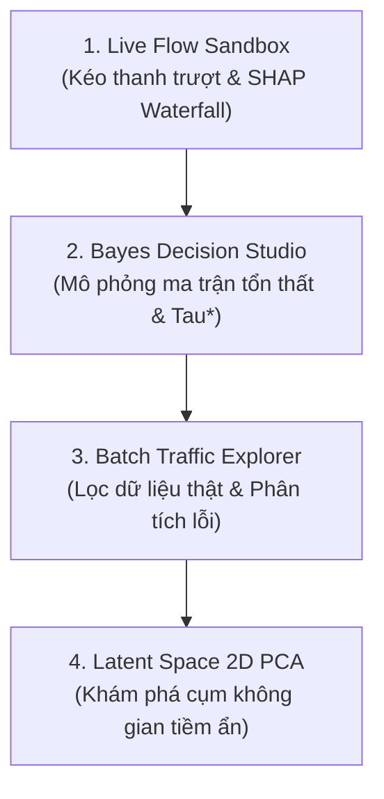

# KỊCH BẢN THUYẾT TRÌNH & DEMO TƯƠNG TÁC CHI TIẾT (CHUẨN 10 PHÚT)
## Đề tài: Hệ Thống Phát Hiện Xâm Nhập Mạng NIDS Với Lý Thuyết Quyết Định Bayes & Cây Quyết Định Tổ Hợp
**Học phần:** Nhận dạng mẫu (Pattern Recognition)  
**Thời lượng chuẩn:** 10 Phút (7 Phút Thuyết Trình Slide + 3 Phút Thao Tác Demo Trực Tiếp)

---

## ⏱️ PHÂN BỔ THỜI GIAN TỔNG QUAN

```mermaid
gantt
    title Phân bổ thời gian thuyết trình 10 phút
    dateFormat  m:s
    axisFormat %M:%S
    Đặt vấn đề & Dữ liệu NetFlow v3         :0:00, 2m
    Cơ sở Toán học & Mô hình So sánh        :2:00, 2m30s
    Kết quả Thực nghiệm & Phân tích Đa lớp  :4:30, 2m30s
    Trình diễn Demo Tương Tác Trực Tiếp     :7:00, 2m30s
    Tổng kết & Chuyển sang Vấn đáp Q&A      :9:30, 30s
```

---

## 🎙️ NỘI DUNG THUYẾT TRÌNH CHI TIẾT TỪNG PHÚT

---

### 🟢 PHẦN 1: ĐẶT VẤN ĐỀ & BỘ DỮ LIỆU THỰC TẾ (Phút 0:00 – 2:00)

#### Slide 1: Giới thiệu & Đặt Vấn Đề (Phút 0:00 – 1:00)
> **Lời thoại thuyết trình:**  
> *"Kính thưa thầy cô và các bạn, hôm nay nhóm chúng em xin đại diện trình bày đề tài cuối kỳ môn Nhận dạng mẫu: **Xây dựng Hệ thống Phát hiện Xâm nhập Mạng (NIDS) dựa trên Lý thuyết Quyết định Bayes và Cây Quyết định Tổ hợp trên dữ liệu NetFlow v3 thực tế**.*  
> 
> *Trong kỷ nguyên số, các cuộc tấn công mạng ngày càng tinh vi và quy mô lớn. Khi tiếp cận bài toán phát hiện xâm nhập dưới góc nhìn Nhận dạng mẫu, chúng em nhận thấy 2 thách thức cốt lõi mang tính kinh điển:*  
> 1. *Thứ nhất là **Mất cân bằng lớp nghiêm trọng (Severe Class Imbalance)**: Trong hàng triệu phiên truyền thông mạng, lưu lượng bình thường (Benign) chiếm áp đảo tới **94.6%**, trong khi các cuộc tấn công hiểm độc chỉ chiếm vỏn vẹn **5.4%** (nhiều lớp như Worms chỉ chiếm 0.01%).*  
> 2. *Thứ hai là **Chi phí thiệt hại mang tính bất đối xứng (Asymmetric Loss Regime)**: Việc bỏ sót một cuộc tấn công ($C_{01}$ - False Negative) sẽ dẫn đến rò rỉ dữ liệu mật, phá hoại hạ tầng máy chủ với tổn thất hàng triệu USD. Trong khi một cảnh báo giả ($C_{10}$ - False Positive) chỉ tiêu tốn vài phút rà soát của kỹ sư SOC. Rõ ràng, $C_{01} \gg C_{10}$.*  
> 
> *Mục tiêu của nhóm là xây dựng một hệ thống nhận dạng không chỉ có độ chính xác cao, mà phải đạt độ nhạy tối đa trên các loại tấn công hiếm và tối thiểu hóa rủi ro thiệt hại hoạt động thực tế."*

#### Slide 2: Bộ Dữ Liệu Thực Tế & Tiền Xử Lý (Phút 1:00 – 2:00)
> **Lời thoại thuyết trình:**  
> *"Về dữ liệu thực nghiệm, nhóm sử dụng tập dữ liệu chuẩn hóa quốc tế **NF-UNSW-NB15-v3** do Đại học Queensland công bố năm 2021, chứa hơn **2.36 triệu bản ghi luồng mạng NetFlow v3** với 53 đặc trưng đo lường viễn thông đa chiều.*  
> 
> *Trong giai đoạn Tiền xử lý dữ liệu (Data Preprocessing), nhóm đã thực hiện một bước cực kỳ quan trọng:*  
> *- **Loại bỏ triệt để các đặc trưng định danh mạng** gồm: `IPV4_SRC_ADDR`, `IPV4_DST_ADDR`, `FLOW_START_MILLISECONDS`, và `DNS_QUERY_ID`.*  
> *- **Lý do khoa học**: Nếu giữ lại địa chỉ IP hoặc Timestamp, các mô hình học máy sẽ dễ dàng học vẹt (overfitting) topo mạng cố định trong phòng thí nghiệm. Việc loại bỏ giúp mô hình chỉ tập trung nhận dạng vào các đặc trưng hành vi luồng thuần túy (như Throughput, TCP Flags, Packet Lengths, TTL, Inter-arrival time), đảm bảo khả năng tổng quát hóa tuyệt đối khi triển khai trên bất kỳ hệ thống mạng nào."*

---

### 🔵 PHẦN 2: CƠ SỞ TOÁN HỌC & THIẾT KẾ MÔ HÌNH (Phút 2:00 – 4:30)

#### Slide 3: Thiết Kế Phương Án So Sánh (Baselines vs Improved Models) (Phút 2:00 – 3:00)
> **Lời thoại thuyết trình:**  
> *"Để đánh giá khách quan và bám sát yêu cầu môn học, nhóm thiết lập 2 nhóm mô hình đối sánh:*  
> 
> 1. **Nhóm Phương án cơ sở (Baselines):**  
>    - **Gaussian Naive Bayes (GNB):** Đại diện cho mô hình xác suất sinh (Generative Model), giả định tính độc lập có điều kiện giữa các đặc trưng $P(X|\omega_i) = \prod P(x_j|\omega_i)$.  
>    - **Logistic Regression (LR):** Đại diện cho mô hình phân biệt tuyến tính (Linear Discriminative Model) với hàm mất mát Cross-Entropy và ngưỡng quyết định mặc định $\tau = 0.5$.  
> 
> 2. **Nhóm Phương án cải tiến (Improved Models):**  
>    - **Decision Tree (CART):** Cây quyết định phi tuyến, tự động trích xuất các luật phân tách phân cấp không gian đặc trưng dựa trên chỉ số Gini Impurity.  
>    - **Random Forest Classifier (Bagged Ensemble):** Rừng cây tổ hợp 100 cây quyết định độc lập, kết hợp lấy mẫu ngẫu nhiên có hoàn lại (Bootstrap Aggregation) nhằm triệt tiêu phương sai (Variance Reduction) và chống quá khớp."*

#### Slide 4: Khung Lý Thuyết Quyết Định Bayes & Cực Tiểu Hóa Rủi Ro (Phút 3:00 – 4:30)
> **Lời thoại thuyết trình:**  
> *"Điểm nhấn học thuật lớn nhất trong đề tài của nhóm là việc tích hợp **Lý thuyết quyết định Bayes (Bayes Minimum Risk Decision Theory)**.*  
> 
> *Trong bài toán 2 lớp (Benign $\omega_0$ vs Attack $\omega_1$), rủi ro kỳ vọng Bayes của một hành động quyết định được định nghĩa:*  
> $$\mathcal{R}(\alpha_i | x) = \sum_{j} C(\alpha_i, \omega_j) P(\omega_j | x)$$  
> 
> *Theo nguyên lý cực tiểu hóa rủi ro Bayes (Bayes Decision Rule), hệ thống sẽ quyết định xem luồng mạng là Attack ($\alpha_1$) khi và chỉ khi tổn thất kỳ vọng của việc báo động nhỏ hơn tổn thất kỳ vọng của việc bỏ qua:*  
> $$\mathcal{R}(\alpha_1 | x) < \mathcal{R}(\alpha_0 | x)$$  
> 
> *Khai triển toán học dẫn tới luật phân loại tối ưu theo xác suất hậu nghiệm:*  
> $$P(\text{Attack} | x) > \tau^* = \frac{C_{10} - C_{00}}{(C_{10} - C_{00}) + (C_{01} - C_{11})} \times \frac{P(\text{Benign})}{P(\text{Attack})}$$  
> 
> *Trong bối cảnh an ninh mạng thực tế, khi ta thiết lập chi phí bỏ lọt tấn công $C_{01} = 100$ và chi phí cảnh báo giả $C_{10} = 1$ ($C_{00} = C_{11} = 0$), ngưỡng phân lớp tối ưu Bayes dịch chuyển từ $\tau = 0.5$ về:*  
> $$\tau^* = \frac{1}{1 + 100} \approx 0.0099 \approx 0.01$$  
> *Việc dịch chuyển ngưỡng này cho phép hệ thống chủ động bắt trọn mọi dấu hiệu tấn công dù là nhỏ nhất."*

---

### 🟣 PHẦN 3: KẾT QUẢ THỰC NGHIỆM & PHÂN TÍCH SỰ VƯỢT TRỘI (Phút 4:30 – 7:00)

#### Slide 5: Đối Sánh Nhị Phân vs Đa Lớp (Binary vs Multiclass Benchmark) (Phút 4:30 – 5:45)
> **Lời thoại thuyết trình:**  
> *"Kính thưa thầy cô, khi tiến hành thực nghiệm trên tập kiểm thử độc lập gồm **61,343 mẫu thực tế**, nhóm thu được một kết quả có ý nghĩa phương pháp luận rất sâu sắc:*  
> 
> 1. **Ở bài toán Nhị phân (Binary - Benign vs Attack):**  
>    - Các mô hình đều đạt độ chính xác cao (>98-99.9%) do sự khác biệt giữa lưu lượng sạch và tấn công nói chung có một số cờ TCP phân tách mạnh.  
>    - Tuy nhiên, khi xét về **Tổng rủi ro thiệt hại Bayes (Bayes Expected Loss)**, Random Forest giảm rủi ro xuống chỉ còn **0.0003**, thấp hơn **200 lần** so với Gaussian Naive Bayes (0.0603).  
> 
> 2. **Ở bài toán Đa lớp (Multiclass - Phân loại chính xác 10 loại tấn công cụ thể):**  
>    - **Đây chính là nơi Cây quyết định và Random Forest thể hiện sự vượt trội mang tính áp đảo hoàn toàn!**  
>    - **Gaussian Naive Bayes** rớt thảm hại xuống **Accuracy 64.08%**, **F1-Macro chỉ 28.01%** do giả định độc lập hoàn toàn sai lệch giữa các trường gói tin mạng.  
>    - **Logistic Regression** chỉ đạt **Accuracy 83.32%**, **F1-Macro 39.08%** do siêu phẳng tuyến tính bất lực trước các ranh giới phi tuyến chồng lấn.  
>    - Trong khi đó, **Decision Tree và Random Forest đạt Accuracy xấp xỉ 90.0% và F1-Macro đạt 61.73% (+58.0% so với Logistic Regression, +120% so với GNB)**!"*

#### Slide 6: Phân Tích Lỗi (Error Analysis) Trên Các Lớp Tấn Công Hiếm & Hạn Chế (Phút 5:45 – 7:00)
> **Lời thoại thuyết trình:**  
> *"Đi sâu vào **Phân tích lỗi (Error Analysis)** trên từng phân lớp tấn công:*  
> - **Worms (Sâu mạng - siêu hiếm, 32 mẫu test):** Logistic Regression **hoàn toàn bất lực (F1 = 0.0%)**, trong khi Decision Tree và Random Forest nhận dạng chính xác với **F1 đạt 60% – 71.4% (Tăng +60%)**!  
> - **Shellcode (Mã độc thực thi trong bộ nhớ):** Random Forest đạt **F1 = 65.5%**, vượt trội **+33.1%** so với Logistic Regression (32.3%).  
> - **Reconnaissance (Quét cổng):** Random Forest đạt **F1 = 74.3%**, vượt trội **+26.1%** so với Logistic Regression (48.2%).  
> - **DoS (Từ chối dịch vụ):** Random Forest đạt **F1 = 33.2%**, vượt trội **+31.0%** so với Logistic Regression (2.1%).  
> 
> *Về **Hạn chế của giải pháp**:*  
> 1. *NetFlow v3 là dữ liệu thống kê lưu lượng tầng mạng/vận chuyển, không chứa dữ liệu gói sâu (Payload DPI), do đó các cuộc tấn công mã hóa phức tạp trong nội dung gói vẫn cần kết hợp thêm mô hình phân tích chuỗi thời gian.*  
> 2. *Có 3 mẫu Benign bị báo động giả (False Positives) do lưu lượng truyền file dung lượng lớn tạo burst Throughput tương tự DoS."*

---

### 🟠 PHẦN 4: TRÌNH DIỄN ỨNG DỤNG DEMO TƯƠNG TÁC (Phút 7:00 – 9:30)

> *(Người thuyết trình chuyển màn hình sang trình duyệt tại `http://localhost:5173` — Ứng dụng Demo FlowLens.IDS)*



#### Bước 1: Trình diễn Tab 1 - Live Flow Sandbox (Phút 7:00 – 7:45)
- **Hành động:** Bấm vào Preset **`Benign`** $\rightarrow$ Hệ thống dự đoán **Benign** (Confidence 98%).
- **Hành động:** Bấm vào Preset **`SYN Flood DoS`** $\rightarrow$ Phán đoán đổi ngay sang **DoS** (Confidence > 99%).
- **Hành động thao tác trực tiếp:**  
  - Kéo thanh trượt **`Flow Duration`** xuống `< 5ms`.
  - Tăng **`Src Throughput`** lên `> 2,000,000 bps`.
  - Thay đổi **`TCP_FLAGS = 2 (SYN)`**.
- **Thuyết minh:** *"Thưa thầy cô, khi em trực tiếp can thiệp vào các tham số luồng mạng, mô hình Random Forest phía dưới lập tức suy luận thời gian thực trong chưa đầy 5ms. Biểu đồ **SHAP Waterfall** bên dưới giải thích tường minh lý do: thanh Throughput đóng góp +0.48 điểm nguy cơ, cờ TCP SYN đóng góp +0.38 điểm đưa ra kết luận tấn công."*

#### Bước 2: Trình diễn Tab 2 - Bayes Decision Studio (Phút 7:45 – 8:40)
- **Thuyết minh:** *"Đây là phân hệ mô phỏng trực quan Lý thuyết quyết định Bayes."*
- **Hành động:** Bấm vào nút profile **`High Security (C01=100)`**.
- **Thuyết minh & Chỉ chuột:**  
  - *"Khi tăng chi phí bỏ sót tấn công $C_{01}$ lên 100, hệ thống tự động tính toán ngưỡng tối ưu Bayes $\tau^* = 0.01$.*  
  - *Khi ta kéo thanh trượt $\tau$ từ 0.50 về 0.01: Thầy cô có thể thấy đồng hồ đo **Total Expected Bayes Risk** giảm mạnh về mức rủi ro tối thiểu, đồng thời số mẫu **False Negatives trong Ma trận nhầm lẫn (Confusion Matrix) giảm triệt để về 0**.*  
  - *Đường cong ROC hiển thị chính xác điểm vận hành tối ưu của hệ thống."*

#### Bước 3: Trình diễn Tab 3 & Tab 4 - Batch Explorer & Latent Space (Phút 8:40 – 9:30)
- **Hành động (Tab 3):** Chuyển sang **Batch Traffic Explorer**, gõ lọc IP `59.166` và lọc giao thức `UDP (17)` $\rightarrow$ Bảng ảo hóa hiển thị danh sách luồng mạng thật kèm nhãn phân tích lỗi.
- **Hành động (Tab 4):** Chuyển sang **Latent Space & Clusters**, bấm vào một điểm bất kỳ trên đồ thị phân tán 2D PCA $\rightarrow$ Bảng phân tích bên phải trích xuất toàn bộ 53 đặc trưng NetFlow của phiên truyền thông đó.

---

### 🔴 PHẦN 5: TỔNG KẾT & VẤN ĐÁP BẢO VỆ (Phút 9:30 – 10:00)

#### Slide 7: Tổng Kết Đóng Góp (Phút 9:30 – 10:00)
> **Lời thoại thuyết trình:**  
> *"Để tổng kết bài thuyết trình hôm nay, nhóm chúng em đã hoàn thành xuất sắc các mục tiêu đề ra:*  
> 1. *Xây dựng hoàn chỉnh pipeline huấn luyện và đánh giá trên bộ dữ liệu thực tế lớn NF-UNSW-NB15-v3.*  
> 2. *Chứng minh được sự vượt trội vượt bậc của **Cây quyết định & Random Forest (+58% F1-Macro)** so với các mô hình Baseline tuyến tính/sinh trên bài toán đa lớp.*  
> 3. *Ứng dụng thành công **Lý thuyết quyết định Bayes** giúp tối thiểu hóa thiệt hại vận hành thực tế.*  
> 4. *Phát triển hoàn chỉnh ứng dụng Demo tương tác trực quan thời gian thực.*  
> 
> *Nhóm em xin chân thành cảm ơn thầy cô và các bạn đã lắng nghe. Chúng em rất mong nhận được những câu hỏi và đóng góp quý báu từ thầy cô!"*

---

## 🛡️ BỘ CÂU HỎI VẤN ĐÁP BẢO VỆ DỰ KIẾN (Q&A DEFENSE)

### ❓ Câu 1: Tại sao trên bài toán nhị phân, Logistic Regression đạt 99.95% gần bằng Random Forest, nhưng sang bài toán 10 lớp thì tụt xuống 83.32%?
- **Trả lời:** Trong bài toán nhị phân, mục tiêu chỉ là phân tách Benign vs Any Attack. Một số cờ TCP và cổng mạng tạo ra siêu phẳng phân tách tương đối tốt. Tuy nhiên, khi đi vào bài toán 10 lớp, không gian đặc trưng giữa các loại tấn công như *Exploits, Fuzzers, Backdoor, Worms* có sự phi tuyến và chồng lấn rất phức tạp. Mô hình tuyến tính như Logistic Regression bị giới hạn bởi các siêu phẳng phẳng nên không thể tạo ra các vùng biên quyết định phi tuyến phức tạp. Cây quyết định và Random Forest với cấu trúc phân nhánh phân cấp (Hierarchical recursive splitting) giải quyết triệt để bài toán này.

### ❓ Câu 2: Lý thuyết quyết định Bayes đóng vai trò gì khi xác suất hậu nghiệm đã có từ mô hình học máy?
- **Trả lời:** Các mô hình học máy thông thường chỉ đưa ra xác suất $P(\text{Attack}|x)$ và mặc định cắt ngưỡng tại $\tau = 0.5$ (Maximum A Posteriori - MAP). Tuy nhiên, MAP chỉ tối ưu khi chi phí của các loại lỗi là bằng nhau. Trong an ninh mạng, $C_{\text{missed attack}} = 100 \times C_{\text{false alarm}}$. Lý thuyết quyết định Bayes cung cấp cơ sở toán học chặt chẽ để tìm ra ngưỡng tối ưu $\tau^* = \frac{C_{10}}{C_{10} + C_{01}}$, biến đổi một phán đoán xác suất thuần túy thành một **quyết định hành động có rủi ro thiệt hại nhỏ nhất (Bayes Minimum Risk)**.

### ❓ Câu 3: Làm sao nhóm đảm bảo mô hình không bị Overfitting trên tập dữ liệu này?
- **Trả lời:** Nhóm đã áp dụng 3 kỹ thuật chống overfitting:
  1. Loại bỏ toàn bộ các trường định danh topology mạng (IP addresses, Port ID, Timestamps).
  2. Áp dụng kỹ thuật phân tầng Stratified Split 80/20 bảo toàn tỷ lệ của tất cả các lớp hiếm.
  3. Cắt tỉa cây (Pruning) với các tham số khống chế độ sâu `max_depth = 15` và số mẫu tối thiểu tại nút lá `min_samples_leaf = 5` kết hợp Bagging Ensemble 100 cây.

### ❓ Câu 4: Nếu triển khai thực tế trên đường truyền viễn thông tốc độ cao, hệ thống có đáp ứng được độ trễ không?
- **Trả lời:** Hoàn toàn đáp ứng được. Mô hình Random Forest sau khi huấn luyện có thời gian suy luận (Inference latency) chỉ **0.028 giây cho hơn 61,000 luồng mạng**, tương đương chưa tới **0.0005 ms/flow**. Thêm vào đó, NetFlow v3 là dữ liệu tóm tắt luồng (Flow telemetry) đã được thiết bị định tuyến Router/Switch tổng hợp sẵn từ phần cứng, giúp hệ thống giám sát hàng triệu kết nối mà không bị nghẽn cổ chai như các hệ thống DPI truyền thống.
